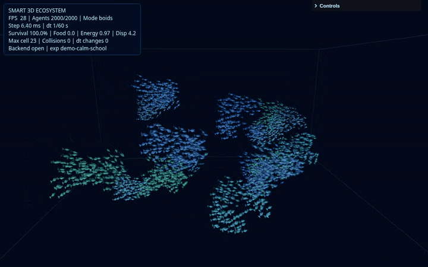
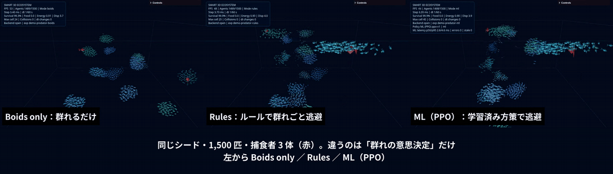
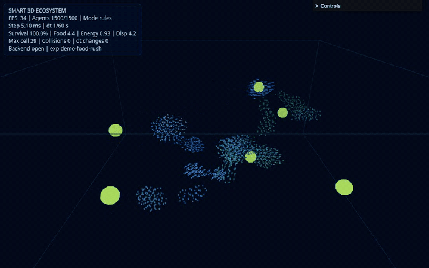
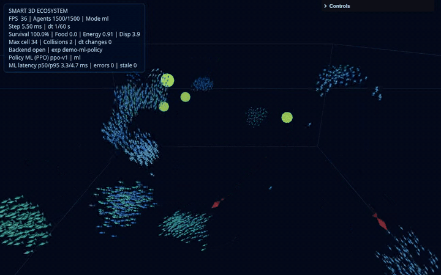
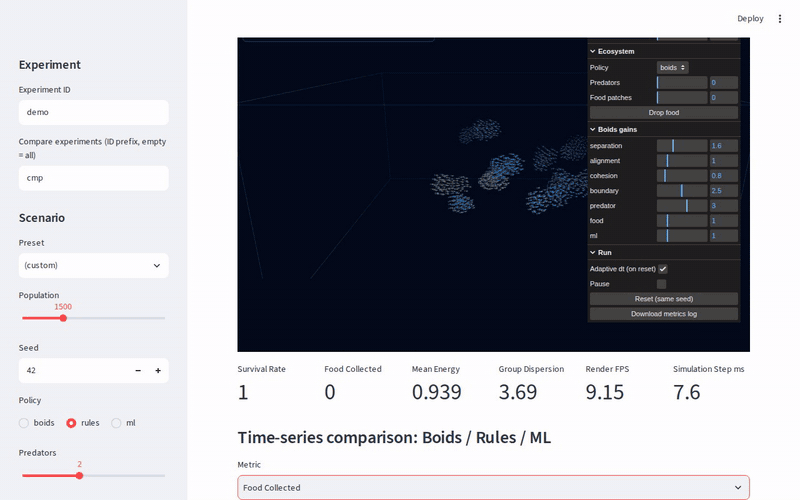
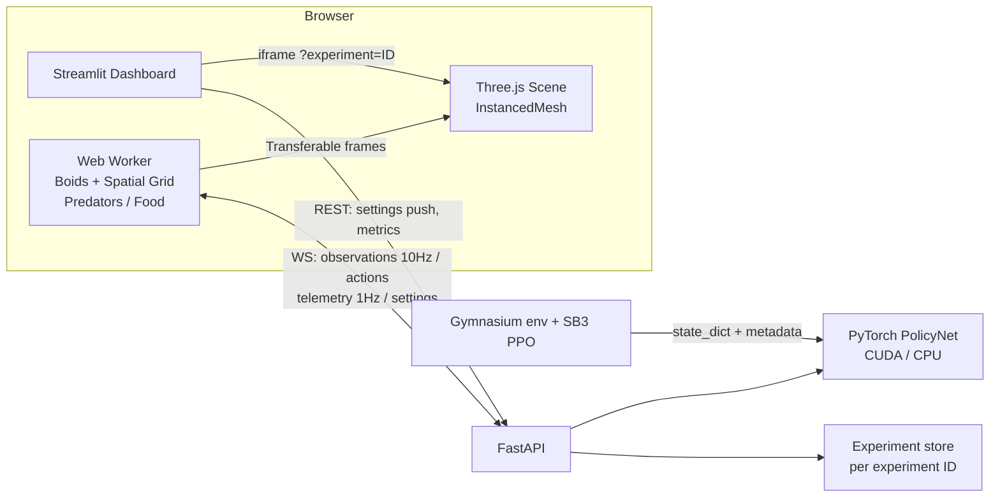

# Smart 3D Ecosystem — Boids + Machine Learning

数千匹の魚が 3D の水中で群れを作り、捕食者から逃げ、餌を探す。その「群れの意思決定」を
**ルールベース**と**学習済み方策（PyTorch / PPO）**で切り替え、**同じ条件で何が違うのかを数値で比べられる**
インタラクティブなデモです。



| 層 | 技術 |
|---|---|
| 3D 描画 | **Three.js**（WebGL2, `InstancedMesh` で全個体を 1 回の描画）、OrbitControls |
| シミュレーション | TypeScript + Web Worker（3D 一様グリッドの近傍探索、固定タイムステップ） |
| ML | PyTorch MLP、Stable-Baselines3 PPO、Gymnasium（RTX A1000 8GB / CUDA） |
| バックエンド | FastAPI + WebSocket |
| ダッシュボード | Streamlit + Plotly |
| 環境・テスト | uv (Python 3.11), npm, pytest, Vitest, Playwright |

- **デモ動画**（約 60 秒・MP4）: [docs/demo/smart-3d-ecosystem-demo.mp4](docs/demo/smart-3d-ecosystem-demo.mp4)
- 設計書: [docs/smart_3d_ecosystem_design.md](docs/smart_3d_ecosystem_design.md) / 進捗と Issue 一覧: [todo.md](todo.md)

---

## このデモの価値

### 1. 「ルールか学習か」を、見た目ではなく数値で判断できる

群れの AI デモは「それっぽく動く」だけで終わりがちです。このデモは、同じシード・同じ捕食者・同じ餌配置で
**Boids only / Rules / ML** の別ランを実行し、生存率・餌獲得量・平均エネルギー・群れの分散・衝突数・
ML 推論レイテンシを 1 秒ごとに記録します。ダッシュボードでは時系列と「ランごとの最終値の平均 ± 標準偏差」を並べます。

- 「この方策は良さそう」を**再現可能な比較**に置き換えられる（シード固定・固定 dt・サブシステムごとに独立した乱数）
- 学習側でも、学習に使っていないシード（10000〜）での評価レポートを CSV / JSON で出力する
- 下の結果のように、**学習済み方策がルールに勝てていないこと**もそのまま見える。これは欠点ではなく、
  「ML を入れる価値があるか」を判断するための材料になる

### 2. 高頻度シミュレーションと ML 推論を疎結合にする設計の実例

数千個体 × 60Hz の物理状態をサーバーと毎フレーム往復させると、帯域もレイテンシも破綻します。このデモは役割を分けています。

| 処理 | どこで | 頻度 | データ量 |
|---|---|---|---|
| Boids の物理更新 | ブラウザの Web Worker | 60Hz | 個体数 × 7 float（スレッド間は Transferable で受け渡し） |
| 描画 | ブラウザのメインスレッド（WebGL） | 毎フレーム | `InstancedMesh` 1 回で全個体 |
| 群れの意思決定（ML） | FastAPI + PyTorch | **10Hz** | **16 グループ × 20 次元の要約だけ** |

ML は「どの方向へ逃げるか・餌をどれだけ優先するか・どれだけ密集するか」という**高水準の戦略**だけを決め、
衝突回避などの低水準制御は常に Boids が担います。ロボット群・ドローン編隊・群衆 / 交通シミュレーションなど、
「大量エージェント + 上位の学習済み意思決定」という構成の雛形として使えます。

> WebGL の描画は**閲覧しているブラウザ側の GPU**で動きます。RTX A1000 を使うのは主に ML の学習・推論です
> （`scripts/check_gpu.py` と `/health` で確認できます）。

### 3. 壊れても止まらない ML 統合（graceful degradation）

本番の ML システムで重要なのは、推論が遅い・落ちる・モデルが無いときの振る舞いです。

- 推論タイムアウト（250ms）、スキーマ不正、サーバー例外、WebSocket 切断が起きても、**直前の行動を 1 秒保持したあと
  決定論的なルールベースに自動で戻る**（HUD に `holding` / `fallback -> rules` と表示）
- 古い tick への応答は捨てる。再接続は指数バックオフ
- チェックポイントが無い・壊れているときは **`Heuristic policy (untrained)`** と表示し、学習済みと偽らない
- バックエンドが無くても、boids / rules モードはブラウザだけで動く（E2E テストで確認）

### 4. 学習と推論のずれを作らない仕組み

- 観測 20 次元・行動 6 次元の契約を [`shared/schemas/policy.json`](shared/schemas/policy.json) に一本化（座標系・単位・上限値も含む）
- 観測の正規化と行動の後処理は Python の 1 箇所にあり、Gymnasium 環境（学習）と FastAPI（推論）が同じコードを使う
- TypeScript と Python の rules 実装は、共有フィクスチャ（`shared/fixtures/rules_cases.json`）で一致をテスト
- PPO の actor は、サーバーが配信する `PolicyNet` に重みを書き出す。SB3 の決定論的な行動と一致することをテストで確認

### 5. 見せ方の幅

| プリセット | 見どころ |
|---|---|
| Calm School | 分離・整列・結合だけで群れが生まれる。重みスライダーで群れの形がリアルタイムに変わる |
| Predator Attack | 捕食者が近づくと群れが分裂・旋回・再集合する。Boids only と Rules の生存率の差 |
| Food Rush | 空腹のグループが餌場を探索し、食べ尽くす |
| ML vs Rules | 同じシナリオで、ML（PPO）とルールを同条件で比較 |

---

## デモ

### 同じシードで捕食者に襲われたとき：Boids only（左）と Rules（右）



Boids only は群れを作るだけで捕食者を避けないため、次々に捕食されます（この場面では約 30 匹）。
Rules は危険半径に入ったグループが逃避方向を選び、壁に張り付かないよう壁沿いに逃げます（同じ場面で数匹）。

### Food Rush：餌場を探索して食べ尽くす



### ML モード：PPO 方策を WebSocket 経由で 10Hz 推論



HUD に `Policy ML (PPO) ppo-v1 | ml`、往復レイテンシ（p50 / p95）、エラー数、棄却した古い応答の数が表示されます。

### ダッシュボード：Boids / Rules / ML のライブ比較



3D シーンの埋め込み、設定の push（ダッシュボード → REST → WebSocket → シーン）、時系列、ランごとの最終値の平均 ± 標準偏差、
学習環境でのオフライン評価と PPO の学習曲線を 1 画面にまとめています。

---

## 結果

### ブラウザ実機での比較（1,500 匹・捕食者 2・餌 4、30 秒、5 シード）

| mode | 生存率 | 餌獲得量 | 平均エネルギー | 捕食数 |
|---|---|---|---|---|
| Boids only | 0.962 ± 0.001 | 5.3 ± 8.1 | 0.42 | 56.4 |
| Rules | **0.994** ± 0.001 | **231.9** ± 23.1 | 0.57 | 9.2 |
| ML（PPO ppo-v1） | **0.994** ± 0.001 | 224.0 ± 24.5 | 0.56 | 9.6 |

`frontend/scripts/generate-runs.ts` で実ブラウザ（headless Chromium）を動かして記録した値です。
リアルタイム実行のため ML の応答タイミングが毎回わずかに違い、ML ランは完全には再現しません。

- 高水準の意思決定を入れるだけで、捕食数は **約 1/6**、餌獲得量は **約 40 倍**になる
- **PPO は現時点で Rules とほぼ同等で、明確には上回っていない**（餌獲得量は 5 シード中 2 シードで上回り、平均では下回る）

### 学習環境でのオフライン評価（学習に使っていない 10 シード）

| policy | 累積報酬 | 生存率 | 餌獲得量 |
|---|---|---|---|
| random | 6.49 ± 23.7 | 0.821 | 25.9 |
| rules | 2.87 ± 16.0 | 0.933 | 7.3 |
| bc-v1（rules の模倣学習） | -5.00 ± 10.3 | 0.927 | 3.6 |
| ppo-v1（bc-v1 から PPO 50 万 step） | -0.70 ± 42.1 | **0.946** | 14.6 |

PPO は生存率が最も高く、餌獲得量も rules の約 2 倍です。一方、累積報酬は random と rules に負けています。
密集するほど衝突ペナルティが増える報酬設計が原因で、学習曲線も途中のピークから下がっています。
報酬設計の見直しは [#18](https://github.com/mutomasa/smart-3d-ecosystem/issues/18) で扱います。

### 性能

| 項目 | 値 |
|---|---|
| Boids 1 ステップ（Node, ヘッドレス） | 1,000 匹 1.5ms / 3,000 匹 7.0ms / 5,000 匹 14.4ms（`npm run bench`） |
| ブラウザ描画 | 1,500 匹で 54〜60 FPS（headless Chromium、開発機） |
| ML 推論（16 グループ一括、サーバー側） | p50 1.0ms / p95 1.3ms |
| ML 往復（ブラウザ ↔ サーバー） | p50 2.7ms / p95 3.4ms（WebSocket を Worker 内で実行） |
| PPO 学習 | 約 1,200 step/s（16 並列環境）、50 万 step で約 7 分 |

3,000 匹 @ 60 FPS は設計上の**目標値**で、保証値ではありません。負荷が高いと自動で dt = 1/30 に切り替わります
（比較実験用に OFF にもできます）。

---

## アーキテクチャ



| ディレクトリ | 内容 |
|---|---|
| `frontend/src/sim/` | Boids コア（`boids.ts`, `spatialGrid.ts`）、捕食者・餌、グループ要約、方策、Worker ランタイム、バックエンド接続 |
| `frontend/src/scene/` | Three.js シーン、魚 / 捕食者 / 餌の `InstancedMesh` 描画 |
| `backend/` | FastAPI、WebSocket、方策（rules / ML）、観測の正規化、実験ストア |
| `training/` | NumPy 版の代表グループ環境、Gymnasium 環境、模倣学習、PPO、評価 |
| `dashboard/` | Streamlit アプリ、集計と Plotly 図 |
| `shared/` | 観測・行動の契約（JSON）、TS / Python 共通のテストフィクスチャ |

---

## セットアップ

```bash
uv sync --all-extras          # Python 3.11 + 依存（training extra 含む）
cd frontend && npm install    # Three.js / Vite / Vitest / Playwright
uv run python scripts/check_gpu.py
```

## 起動

```bash
./scripts/dev.sh                    # FastAPI :8000 / Vite :5173 / Streamlit :8501
BACKEND_PORT=8010 ./scripts/dev.sh  # 8000 が使用中の場合（Vite proxy / Streamlit も追従）
```

- 3D シーン: http://localhost:5173/ （URL でシナリオを指定可: `?preset=Food%20Rush&mode=ml&seed=3&experiment=run-1`）
- ダッシュボード: http://localhost:8501/
- Vite を単独で動かす場合は `BACKEND_URL=http://localhost:8010 npm run dev` でプロキシ先を変更できる

本番と同じ構成（FastAPI がビルド済みフロントを配信）で動かす場合:

```bash
cd frontend && npm run build && cd ..
POLICY_CHECKPOINT=backend/models/ppo.pt uv run uvicorn backend.main:app --port 8000   # http://localhost:8000/
```

## 学習・評価

```bash
# 1) 模倣学習: rules を Behavior Cloning して最初の ML 方策 (bc-v1) を作る（A1000 で約 45 秒）
uv run python -m training.imitation                       # -> backend/models/policy.pt (+ .json)

# 2) PPO: Gymnasium 環境 (training/env.py) で bc-v1 から初期化して学習
uv run python -m training.train_ppo --timesteps 500000 --init-from backend/models/policy.pt \
    --version ppo-v1 --out backend/models/ppo.pt          # 学習曲線: outputs/ppo/ppo-v1/learning_curve.csv

# 3) 評価: 学習と分離したシード (10000〜) で random / rules / 各チェックポイントを比較
uv run python -m training.evaluate --seeds 10 \
    --checkpoint bc-v1=backend/models/policy.pt --checkpoint ppo-v1=backend/models/ppo.pt
#    -> outputs/eval/<timestamp>/{results.csv,summary.csv,summary.json}, outputs/eval/latest.json

# 4) サーバーで使うモデルを切り替える
POLICY_CHECKPOINT=backend/models/ppo.pt uv run uvicorn backend.main:app --port 8000
```

- 学習環境は代表 1 グループ（既定 48 匹）の NumPy 実装です。ブラウザのシミュレーションとは規模・一部実装が異なる
  （sim-to-sim ギャップ）ため、最終的な比較はブラウザ側のテレメトリでも確認してください
- `backend/models/` と `outputs/` は Git 管理外です

## テスト

```bash
uv run pytest                   # API / WebSocket / 方策 / 正規化 / 環境 / 学習 / ダッシュボード
cd frontend && npm test         # Boids の数値性質 / 空間グリッド / Worker / 描画バッファ / ML 連携
cd frontend && npm run e2e      # Playwright: 描画・プリセット・バックエンド無しでの ML 劣化動作
cd frontend && npm run bench    # ヘッドレス性能ベンチマーク
cd frontend && npm run compare  # ヘッドレスで boids vs rules を同シード比較
```

設計書の必須テスト（距離 0 で NaN なし、10,000 ステップ後も有限、個体数変更時の描画バッファ整合、固定シードでの再現、
不正スキーマ / タイムアウト時の rules フォールバック、実験 ID の非混線、学習と推論で同一の正規化）をすべて含みます。

## デモ素材の再生成

```bash
cd frontend && npm run build && cd ..
POLICY_CHECKPOINT=backend/models/ppo.pt uv run uvicorn backend.main:app --port 8010 &
API_URL=http://localhost:8010 SCENE_URL=http://localhost:8010/ uv run streamlit run dashboard/app.py --server.port 8502 &
cd frontend
BASE_URL=http://localhost:8010 npx tsx scripts/record-demo.ts ../docs/demo/raw   # 各シーンを録画
BASE_URL=http://localhost:8010 npx tsx scripts/generate-runs.ts 30 1,2,3,4,5     # 比較用ラン
DASHBOARD_URL=http://localhost:8502 npx tsx scripts/record-dashboard.ts ../docs/demo/raw
cd .. && ./scripts/make_demo_media.sh                                            # GIF / MP4 を生成
```

## 既知の制約と今後

- PPO の報酬設計（衝突ペナルティが支配的、学習途中で劣化）: [#18](https://github.com/mutomasa/smart-3d-ecosystem/issues/18)
- 学習環境（NumPy, 1 グループ）とブラウザ（TypeScript, 16 グループ）は別実装
- Phase 5（尾びれ・軌跡・ブルーム、負荷時の段階的な画質低下、WebGPU Compute）は未着手
- 開発中に見つけて修正した問題（群れの崩壊、dt の誤切替、壁への張り付き、ML レイテンシ、ポート固定、比較データの混入）は
  [todo.md](todo.md) の Issue 一覧を参照
