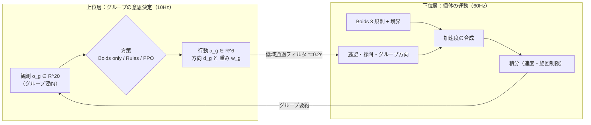

# アルゴリズム解説：Boids と PPO

このページでは、Smart 3D Ecosystem の中核にある 2 つのアルゴリズムを、理論と数式で解説します。

- **Boids**：魚 1 匹ずつの運動を決める局所ルール（毎秒 60 ステップ）
- **PPO**：魚群のグループ単位の意思決定を学習する強化学習（毎秒 10 回）

数式はできるだけ実装（`frontend/src/sim/*`, `training/*`, `backend/*`）と一致させています。既定値も実装の値です。

---

## 目次

1. [全体像：2 層の制御](#1-全体像2-層の制御)
2. [Boids](#2-boids)
3. [群れの意思決定を強化学習問題として定式化する](#3-群れの意思決定を強化学習問題として定式化する)
4. [PPO（Proximal Policy Optimization）](#4-ppoproximal-policy-optimization)
5. [模倣学習によるウォームスタート](#5-模倣学習によるウォームスタート)
6. [考察：なぜ PPO は Rules を超えていないか](#6-考察なぜ-ppo-は-rules-を超えていないか)
7. [実装との対応表](#7-実装との対応表)
8. [参考文献](#8-参考文献)

---

## 1. 全体像：2 層の制御



数千匹の魚それぞれを強化学習で直接制御すると、行動空間が巨大になり、学習も推論も現実的ではありません。そこで次の 2 層に分けています。

- **下位層（Boids）**：魚 1 匹ずつの「ぶつからない・揃う・まとまる」という反射的な運動。
- **上位層（方策）**：グループ（既定は 16 グループ）単位で決める「どちらへ向かうか」「逃避・採餌・結合をどれだけ重視するか」。

方策が変えるのは上位層だけです。そのため Boids only / Rules / PPO の 3 つを、同じ物理（下位層）の上で公平に比べられます。

---

## 2. Boids

### 2.1 背景

Boids は Craig Reynolds（1987）が提案した群れのモデルです。各個体が近くの仲間だけを見て、次の 3 つの規則に従うだけで、全体として群れらしい振る舞いが現れます（**創発**）。

| 規則 | 直感 |
|---|---|
| 分離（Separation） | 近すぎる仲間から離れる |
| 整列（Alignment） | 仲間と進行方向を揃える |
| 結合（Cohesion） | 仲間の中心へ寄る |

中央の指揮者はいません。それぞれの個体は局所的な情報しか使わないため、計算量は個体数に対してほぼ線形に抑えられます（[2.9](#29-近傍探索3d-一様グリッド) を参照）。

### 2.2 記号

| 記号 | 意味 | 既定値 |
|---|---|---|
| $\mathbf{p}_i, \mathbf{v}_i \in \mathbb{R}^3$ | 個体 $i$ の位置・速度 | — |
| $R$ | 知覚半径（整列・結合の近傍） | 4 |
| $r_s$ | 分離半径 | 1.6 |
| $r_c$ | 衝突判定半径（計測用） | 0.3 |
| $K$ | 整列・結合に使う近傍数の上限 | 48 |
| $v_{\min}, v_{\max}$ | 速さの下限・上限 | 3, 10 |
| $F_{\max}$ | 加速度（操舵力）の上限 | 25 |
| $\omega_{\max}$ | 最大旋回角速度 | $1.5\pi$ rad/s |
| $\Delta t$ | 固定時間刻み | 1/60 s |
| $\mathbf{h} = (h_x,h_y,h_z)$ | 世界の半径（箱 $[-h, h]$） | (50, 25, 50) |
| $m$ | 境界マージン | 8 |

### 2.3 近傍

個体 $i$ の知覚近傍と分離近傍を、次のように定めます。

```math
\mathcal{N}_i = \{\, j \ne i : \lVert \mathbf{p}_j - \mathbf{p}_i \rVert < R \,\},\qquad
\mathcal{S}_i = \{\, j \ne i : \lVert \mathbf{p}_j - \mathbf{p}_i \rVert < r_s \,\}
```

- 整列と結合には、$\mathcal{N}_i$ のうち走査順で先頭の最大 $K$ 個だけを使います（**トポロジカル近傍**）。$\mathcal{N}_i^{K}$ と書きます。
- 分離には $\mathcal{S}_i$ の**全員**を使います。

この非対称な扱いには理由があります。分離まで打ち切ると、高密度のときに押し返しが足りなくなり、群れが 1 セルに潰れました（Issue #3）。整列と結合は平均を取る量なので、打ち切っても質的な影響は小さく済みます。走査は自セルから始めるので、近い仲間ほど $\mathcal{N}_i^K$ に入りやすくなっています。

### 2.4 Reynolds の操舵（steering）

Boids の各規則は「望ましい速度」を出し、そこへ向かう操舵力を返します。

```math
\operatorname{steer}(\mathbf{u};\, \mathbf{v}) =
\operatorname{clamp}\!\left( v_{\max}\,\frac{\mathbf{u}}{\lVert\mathbf{u}\rVert} - \mathbf{v},\; F_{\max} \right),
\qquad
\operatorname{clamp}(\mathbf{x}, c) = \mathbf{x}\cdot\min\!\left(1, \frac{c}{\lVert \mathbf{x} \rVert}\right)
```

- 方向 $\mathbf{u}$ に最高速 $v_{\max}$ で進みたいときの速度差が、そのまま力になります。$\lVert\mathbf{u}\rVert = 0$ のときは $\mathbf{0}$ を返します。
- 大きさが $F_{\max}$ で頭打ちになるので、どの規則の力も有界です。そのため数値的に暴れません。

### 2.5 3 つの基本規則

**分離**：近い仲間ほど強く押し返します。

```math
\mathbf{s}_i = -\sum_{j \in \mathcal{S}_i} \frac{\mathbf{p}_j - \mathbf{p}_i}{\lVert \mathbf{p}_j - \mathbf{p}_i \rVert^{2}},
\qquad
\mathbf{F}^{\text{sep}}_i = \operatorname{steer}(\mathbf{s}_i;\, \mathbf{v}_i)
```

- 各項は大きさが $1/d$ のベクトルです（単位ベクトルを距離 $d$ で割ったもの）。
- 位置が完全に一致した場合（$d^2 < \varepsilon$）は 0 除算を避けます。代わりにインデックスの大小で決まる $\pm\mathbf{e}_x$ で押し分けるので、結果は決定的です。

**整列**：仲間の平均速度の向きへ揃えます。

```math
\mathbf{F}^{\text{ali}}_i = \operatorname{steer}\!\Big(\sum_{j\in\mathcal{N}_i^K} \mathbf{v}_j;\; \mathbf{v}_i\Big)
```

操舵関数が正規化するので、平均ではなく総和でも向きは同じです。

**結合**：仲間の重心へ向かいます。

```math
\bar{\mathbf{p}}_i = \frac{1}{|\mathcal{N}_i^K|}\sum_{j\in\mathcal{N}_i^K}\mathbf{p}_j,
\qquad
\mathbf{F}^{\text{coh}}_i = \operatorname{steer}(\bar{\mathbf{p}}_i - \mathbf{p}_i;\; \mathbf{v}_i)
```

近傍が空のとき、各規則の力は $\mathbf{0}$ です。

### 2.6 境界：滑らかな押し戻し

壁で反射させると不自然に見え、群れも割れます。そこで、壁から $m$ 以内に入った深さに比例して押し戻します。軸 $k$ ごとの押し戻し量は次の通りです。

```math
b_k(\mathbf{p}) =
\begin{cases}
-\min\!\big(1, \frac{p_k - (h_k - m)}{m}\big) & p_k > h_k - m \\[2pt]
\phantom{-}\min\!\big(1, \frac{-(h_k - m) - p_k}{m}\big) & p_k < -(h_k - m) \\[2pt]
0 & \text{otherwise}
\end{cases}
\qquad
\mathbf{F}^{\text{bnd}}_i = \lVert \mathbf{b} \rVert_\infty \cdot \operatorname{steer}(\mathbf{b};\, \mathbf{v}_i)
```

$\lVert \mathbf{b} \rVert_\infty = \max_k |b_k| \in [0,1]$ が侵入の深さを表します。

**外向き成分の除去**：逃避や目標追従の力は、そのままだと群れを壁に押し付けてしまいます（Issue #9）。そこで、マージン内では力の外向き成分を $(1-|b_k|)$ 倍に弱めます。

```math
\big[\operatorname{removeOutward}(\mathbf{f})\big]_k =
\begin{cases}
f_k\,(1 - |b_k|) & f_k \text{ が壁の外向き} \\
f_k & \text{otherwise}
\end{cases}
```

この処理で、壁際では力が壁に沿って「滑る」ようになります。

### 2.7 上位層からの追加項

方策が決めるグループ $g$ の戦略を $(\mathbf{d}_g, w^{\text{pred}}_g, w^{\text{food}}_g, w^{\text{coh}}_g)$ とします。$\lVert \mathbf{d}_g \rVert \le 1$ で、各重みは $[0,1]$ です。これらは次の 3 つの追加項を通じて個体の運動に効きます。$W_\bullet$ は全体の重み（[2.8](#28-加速度の合成と積分) の表）です。

**捕食者からの逃避**（危険半径 $r_d = 18$ 以内の捕食者 $\mathbf{q}$ について和を取る）：

```math
\mathbf{F}^{\text{pred}}_i = \operatorname{removeOutward}\!\left(
\sum_{\mathbf{q}:\, d < r_d} W_{\text{pred}}\, w^{\text{pred}}_g\, F_{\max}
\left(1 - \frac{d}{r_d}\right)
\frac{\mathbf{p}_i - \mathbf{q}}{d}
\right),\quad d = \lVert \mathbf{p}_i - \mathbf{q} \rVert
```

捕食者に近いほど線形に強くなり、危険半径の縁では 0 になります。そのため力が連続で、急な切り替わりが起きません。

**採餌**（感知半径 35 以内で最寄りの、残量がある餌 $\mathbf{f}$ へ向かう）：

```math
\mathbf{F}^{\text{food}}_i = W_{\text{food}}\, w^{\text{food}}_g\, F_{\max}\,
\big(0.25 + 0.75\,(1 - e_i)\big)\,
\frac{\mathbf{f} - \mathbf{p}_i}{\lVert \mathbf{f} - \mathbf{p}_i \rVert}
```

$e_i \in [0,1]$ は個体のエネルギーです。空腹なほど強く引かれます。エネルギーは毎秒 0.02 ずつ減り、餌の半径 3 以内にいる間は毎秒 0.5 ずつ回復します（そのぶん餌の残量が減ります）。

**グループ方向**（方策の $\mathbf{d}_g$ に従う）：

```math
\hat{\mathbf{d}} = \operatorname{removeOutward}\!\left(\frac{\mathbf{d}_g}{\lVert\mathbf{d}_g\rVert}\right),\qquad
\mathbf{F}^{\text{ml}}_i = W_{\text{ml}}\, F_{\max}\, \min(1, \lVert\mathbf{d}_g\rVert)\,
\frac{v_{\max}\hat{\mathbf{d}} - \mathbf{v}_i}{\lVert v_{\max}\hat{\mathbf{d}} - \mathbf{v}_i\rVert}
```

$\lVert\mathbf{d}_g\rVert$ は「その方向へ行きたい強さ」を表します。$\mathbf{d}_g = \mathbf{0}$ は「希望なし」の意味で、この項は消えます（$\lVert\mathbf{d}_g\rVert < 10^{-3}$ で打ち切り）。

**結合の強さ**：$w^{\text{coh}}_g$ は結合の重みを $2\,w^{\text{coh}}_g$ 倍します。$w^{\text{coh}}_g = 0.5$ のとき素の Boids と同じになります。

**戦略の平滑化**：方策は 10Hz で目標 $\mathbf{x}^\ast$ を出します。シミュレーションは毎ステップ、その目標へ一次遅れで追従します。

```math
\mathbf{x} \leftarrow \mathbf{x} + (\mathbf{x}^\ast - \mathbf{x})\left(1 - e^{-\Delta t / \tau}\right),\qquad \tau = 0.2\ \text{s}
```

これは時定数 $\tau$ の一次ローパスフィルタ $\dot{\mathbf{x}} = (\mathbf{x}^\ast - \mathbf{x})/\tau$ の厳密な離散化です。10Hz の離散的な指令が、60Hz の運動に段差を作らないようにしています。

### 2.8 加速度の合成と積分

**合成**：

```math
\mathbf{a}_i = \operatorname{clamp}\!\Big(
W_{\text{sep}}\mathbf{F}^{\text{sep}}_i + W_{\text{ali}}\mathbf{F}^{\text{ali}}_i
+ 2 w^{\text{coh}}_g W_{\text{coh}}\mathbf{F}^{\text{coh}}_i + W_{\text{bnd}}\mathbf{F}^{\text{bnd}}_i
+ \mathbf{F}^{\text{pred}}_i + \mathbf{F}^{\text{food}}_i + \mathbf{F}^{\text{ml}}_i,\; F_{\max} \Big)
```

| 重み | $W_{\text{sep}}$ | $W_{\text{ali}}$ | $W_{\text{coh}}$ | $W_{\text{bnd}}$ | $W_{\text{pred}}$ | $W_{\text{food}}$ | $W_{\text{ml}}$ |
|---|---|---|---|---|---|---|---|
| 既定値 | 1.6 | 1.0 | 0.8 | 2.5 | 3.0 | 1.0 | 1.0 |

各項は個別に $F_{\max}$ 以下ですが、合計は最後にもう一度 $F_{\max}$ でクリップします。重みが大きい項（分離・境界・逃避）ほど合力の向きを支配するので、実質的な優先順位になります。

**積分**（半陰的オイラー法に、速さと旋回の制限を加えたもの）：

```math
\tilde{\mathbf{v}} = \mathbf{v}_i + \mathbf{a}_i \Delta t,\qquad
s = \operatorname{clip}\big(\lVert\tilde{\mathbf{v}}\rVert,\, v_{\min},\, v_{\max}\big)
```

```math
\mathbf{v}_i' = s\cdot \operatorname{rotTowards}\!\left(\hat{\mathbf{v}}_i,\, \hat{\tilde{\mathbf{v}}},\, \omega_{\max}\Delta t\right),\qquad
\mathbf{p}_i' = \operatorname{clip}\big(\mathbf{p}_i + \mathbf{v}_i'\Delta t,\ \pm 1.1\,\mathbf{h}\big)
```

**旋回制限**：$\operatorname{rotTowards}$ は球面線形補間（slerp）です。現在の向き $\hat{\mathbf{u}}$ から目標の向き $\hat{\mathbf{w}}$ へ、最大角 $\varphi = \omega_{\max}\Delta t$ だけ回します。$\theta = \arccos(\hat{\mathbf{u}}\cdot\hat{\mathbf{w}})$ として次の通りです。

```math
\operatorname{rotTowards}(\hat{\mathbf{u}}, \hat{\mathbf{w}}, \varphi) =
\begin{cases}
\hat{\mathbf{w}} & \theta \le \varphi \\[4pt]
\dfrac{\sin(\theta - \varphi)\,\hat{\mathbf{u}} + \sin\varphi\,\hat{\mathbf{w}}}{\sin\theta} & \theta > \varphi
\end{cases}
```

- 真逆の向き（$\sin\theta \approx 0$）では回転軸が決まらないので、今の向きを保ちます。
- **速さの下限**：$v_{\min} > 0$ にしているのは、魚が静止して向きが定義できなくなるのを防ぐためです。
- **安全壁**：$\pm 1.1\mathbf{h}$ のクリップは、柔らかい境界をすり抜けたときの最後の安全策です。

### 2.9 近傍探索：3D 一様グリッド

素朴に全ペアを調べると $O(N^2)$ です。そこで、セル幅を知覚半径 $R$ に等しくした一様グリッドを使います。

- **セル数**：世界は $100 \times 50 \times 100$ なので、$\lceil 2h_k / R \rceil$ から $25 \times 13 \times 25 = 8{,}125$ セルになります。
- **正しさ**：セル幅 $\ge R$ なので、半径 $R$ 以内の仲間は必ず「自セルと周囲 26 セル」の計 27 セルに入っています。この 27 セルを走査すれば取りこぼしはありません。
- **構築（毎ステップ）**：計数ソートで $O(N + C)$ です（$C$ はセル数）。
  1. 各個体のセル番号を数える
  2. 累積和で各セルの開始位置を求める
  3. 個体インデックスをセル順に並べる
- **探索**：27 セルそれぞれについて、並べ替えた配列上の区間 `[start, end)` を返すだけです。コピーも打ち切りもしません。
- **計算量**：局所密度を $\rho$ とすると、1 個体あたりの候補数の期待値はおよそ $27R^3\rho$ です。そのうち本当に半径 $R$ の球に入るのは $\frac{4}{3}\pi R^3 \rho$ なので、効率は $\frac{4\pi/3}{27} \approx 15.5\%$ です。全体の計算量は $O(N \cdot \rho R^3)$ で、密度が一定なら $N$ に線形です。

### 2.10 ダブルバッファと決定性

全個体の新しい状態は、**前ステップの状態だけから**計算して別バッファに書き込み、最後にまとめて入れ替えます。

```math
(\mathbf{p}^{t+1}, \mathbf{v}^{t+1}) = \Phi(\mathbf{p}^{t}, \mathbf{v}^{t})
```

ヤコビ法と同じ形の同時更新です。更新順に結果が依存しません（ガウス＝ザイデル法のように、先に更新した個体の影響が後の個体に混ざることがありません）。これにシード付き乱数（mulberry32）と固定 $\Delta t$ を組み合わせているので、同じシードなら同じ軌跡が再現されます。モード比較が公平になるのはこの性質のおかげです。

### 2.11 Rules 方策（手設計のベースライン）

グループの観測（生の値）から、次の if-then 規則で戦略を決めます。$\mathbf{r}^{\text{pred}}$ と $\mathbf{r}^{\text{food}}$ は、グループ中心から最寄りの捕食者・餌への相対ベクトルです。

| 条件 | 方向 $\mathbf{d}_g$ | $(w^{\text{pred}}, w^{\text{food}}, w^{\text{coh}})$ |
|---|---|---|
| 捕食者がいて、距離 $< 25$ | $-\mathbf{r}^{\text{pred}}$（逃げる） | (1.0, 0.1, 0.8) |
| 餌があり、平均エネルギー $< 0.7$ | $\mathbf{r}^{\text{food}}$（向かう） | (0.6, 1.0, 0.4) |
| それ以外 | $\mathbf{0}$（巡航） | (0.6, 0.3, 0.5) |

方向は長さ 1 にクリップされます。逃避中に結合を強めて（0.8）群れを固めるのは、魚が群れることで捕食されにくくなる効果を狙ったものです。Boids only は常に $\mathbf{d}_g = \mathbf{0}$, $(0, 0, 0.5)$ です。

---

## 3. 群れの意思決定を強化学習問題として定式化する

### 3.1 マルコフ決定過程（MDP）

PPO の学習には、ブラウザのシミュレーションを NumPy で移植した Gymnasium 環境 `FishSchoolEnv` を使います。代表として 1 グループ（48 匹）を扱います。

| 要素 | 定義 |
|---|---|
| 観測 $o_t \in [-5, 5]^{20}$ | グループ要約 20 次元を正規化したもの（3.2） |
| 行動 $a_t \in [-5, 5]^{6}$ | 方策の生出力。環境の中で後処理する（3.3） |
| 遷移 | 1 回の決定につき $\Delta t_{\text{sim}} = 1/30$ s のシミュレーションを 3 サブステップ進める（決定周期 0.1 s = 10Hz） |
| エピソード | 30 秒（300 決定）。全滅したら終了（terminated）、時間切れは打ち切り（truncated） |
| ランダム化 | 捕食者 1〜2 体、餌 2〜3 箇所、捕食者の速さ $U(9.5, 11.5)$ |

本来はグループごとに観測される**部分観測**の問題です。それを、グループ要約を状態とみなして MDP として扱っています。

### 3.2 観測と正規化

グループ $g$ の生の特徴量 $\mathbf{x} \in \mathbb{R}^{20}$ は次の通りです。

- 中心位置・平均速度
- 最寄りの捕食者・餌への相対ベクトルと距離
- 平均エネルギー・密度・分散
- 近くのグループ数
- 捕食者・餌の有無フラグ

これを、特徴量ごとのスケール $\mathbf{c}$（世界の半径、最高速 12、最大距離 150 など）で割り、クリップします。

```math
o = \operatorname{clip}\!\left(\frac{\mathbf{x}}{\mathbf{c}},\, -5,\, 5\right)
```

捕食者や餌がいないときは、相対ベクトル $= \mathbf{0}$、距離 $= 150$、フラグ $= 0$ という番兵値を入れます。この正規化は Python の `backend/normalization.py` の 1 箇所だけで行い、学習時にも推論時にも同じ関数を通します。

### 3.3 行動の後処理

方策の生出力 $a \in \mathbb{R}^6$ を、次の後処理で戦略に変換します。学習と推論で共通の `backend/actions.py` です。

```math
\tilde{a} = \operatorname{clip}(a, -5, 5),\qquad
\mathbf{d} = \frac{\tilde{a}_{1:3}}{\max(1, \lVert \tilde{a}_{1:3} \rVert)},\qquad
\mathbf{w} = \sigma(\tilde{a}_{4:6}) = \frac{1}{1 + e^{-\tilde{a}_{4:6}}}
```

方向は「長さ 1 以下」に制限します（正規化はしません）。こうしておくと、$\mathbf{0}$ 付近の出力が任意の単位ベクトルに化けることがなく、「希望なし」を表現できます。

### 3.4 報酬

1 決定（$\Delta t = 0.1$ s）あたりの報酬は次の通りです。

```math
r_t = \underbrace{1.0\, F_t}_{\text{採餌}}
+ \underbrace{0.2\, \bar{\alpha}_t \Delta t}_{\text{生存}}
+ \underbrace{0.1\, e^{-D_t/10} \Delta t}_{\text{結合}}
- \underbrace{2.0\, C_t}_{\text{捕食}}
- \underbrace{0.05\, K_t}_{\text{衝突}}
- \underbrace{0.01\, \lVert u_t - u_{t-1} \rVert^2}_{\text{操舵の急変}}
```

| 記号 | 意味 |
|---|---|
| $F_t$ | このステップで食べた餌の量 |
| $\bar\alpha_t$ | 生存率 |
| $D_t$ | 群れの分散（中心からの平均距離） |
| $C_t$ | 捕食された匹数 |
| $K_t$ | サブステップあたりの平均接触ペア数（$r_c$ 以内） |
| $u_t$ | 後処理した行動 |

- **衝突項の正規化**：$K_t$ をサブステップで平均しているのは、シミュレーションの刻み幅を変えても罰の大きさが変わらないようにするためです。
- **目的**：割引累積報酬（リターン）の期待値の最大化です。

```math
J(\pi) = \mathbb{E}_{\tau\sim\pi}\Big[\sum_{t=0}^{T-1} \gamma^t r_t\Big],\qquad \gamma = 0.99
```

$\gamma = 0.99$ の実効ホライズンはおよそ $1/(1-\gamma) = 100$ 決定、つまり 10 秒です。捕食者から逃げるといった数秒先の結果を、価値に反映できる長さです。

---

## 4. PPO（Proximal Policy Optimization）

PPO は**方策勾配法**の一種です。方策 $\pi_\theta(a \mid s)$ をパラメータ $\theta$ で表し、$J(\theta)$ の勾配で直接更新します。価値関数 $V_\phi(s)$ も一緒に学習する **Actor-Critic** 型で、方策の更新幅を確率比のクリップで抑えることで安定させます。

### 4.1 方策勾配定理

軌跡 $\tau = (s_0, a_0, r_0, s_1, \dots)$ の確率は次のように分解できます。

```math
p_\theta(\tau) = \rho_0(s_0)\prod_t \pi_\theta(a_t\mid s_t)\,P(s_{t+1}\mid s_t,a_t)
```

**対数微分トリック** $\nabla_\theta p_\theta = p_\theta \nabla_\theta \log p_\theta$ を使います。環境の遷移 $P$ は $\theta$ に依存しないので、$\nabla_\theta \log p_\theta(\tau)$ には方策の項だけが残ります。

```math
\nabla_\theta J(\theta)
= \mathbb{E}_{\tau\sim\pi_\theta}\!\left[ \sum_t \nabla_\theta \log \pi_\theta(a_t\mid s_t)\; G_t \right],
\qquad G_t = \sum_{k\ge t}\gamma^{k-t} r_k
```

直感的には「結果が良かった行動の対数確率を上げる」更新です。環境のモデル（遷移確率）を知らなくても、サンプルから勾配を推定できます。これが REINFORCE（Williams, 1992）です。

### 4.2 ベースラインとアドバンテージ

$G_t$ をそのまま使うと推定の分散が非常に大きくなります。状態だけに依存する関数 $b(s)$ を引いても勾配の期待値は変わりません。

```math
\mathbb{E}_{a\sim\pi_\theta}\big[\nabla_\theta \log\pi_\theta(a\mid s)\, b(s)\big]
= b(s)\,\nabla_\theta \!\int\! \pi_\theta(a\mid s)\,da = b(s)\,\nabla_\theta 1 = 0
```

最適に近いベースラインは状態価値 $V^\pi(s)$ です。そのときの重みが**アドバンテージ**です。

```math
A^\pi(s,a) = Q^\pi(s,a) - V^\pi(s)
```

「その行動は、その状態での平均よりどれだけ良かったか」を表します。Critic $V_\phi$ はこの $V^\pi$ を回帰で近似します。

### 4.3 GAE（Generalized Advantage Estimation）

1 ステップの TD 誤差を次のように定めます。$\text{done}$ は終了フラグです。

```math
\delta_t = r_t + \gamma (1 - \text{done}_{t+1})\, V_\phi(s_{t+1}) - V_\phi(s_t)
```

GAE はこれを指数重み $\lambda$ で足し合わせます（Schulman et al., 2016）。

```math
\hat{A}_t = \sum_{l=0}^{\infty} (\gamma\lambda)^l\, \delta_{t+l}
\quad\Longleftrightarrow\quad
\hat{A}_t = \delta_t + \gamma\lambda(1-\text{done}_{t+1})\,\hat{A}_{t+1}
```

$\lambda$ でバイアスと分散のトレードオフを調整します。

| $\lambda$ | 推定量 | バイアス | 分散 |
|---|---|---|---|
| 0 | $\delta_t$（1 ステップ TD） | 大（$V_\phi$ の誤差に依存） | 小 |
| 1 | $G_t - V_\phi(s_t)$（モンテカルロ） | 小 | 大 |
| **0.95**（本実装） | 中間 | 中 | 中 |

- **価値関数の学習目標**：$\hat{R}_t = \hat{A}_t + V_\phi(s_t)$ です。
- **時間切れの扱い**：30 秒の時間切れ（truncated）は、本当の終了ではありません。Stable-Baselines3 は打ち切られた時点の観測の価値 $\gamma V_\phi(s_T)$ を報酬に足してブートストラップします。こうして「時間切れ＝価値 0」という誤った学習を避けています。

### 4.4 代理目的関数と信頼領域

方策勾配で大きなステップを踏むと、方策が崩れて二度と回復しないことがあります。オンポリシー手法では、崩れた方策で集めたデータでしか次の更新ができないからです。そこで、データを集めた古い方策 $\pi_{\theta_{\text{old}}}$ を基準にした**重点サンプリング**の代理目的関数を考えます。

```math
L^{\text{CPI}}(\theta) = \hat{\mathbb{E}}_t\!\left[ r_t(\theta)\, \hat{A}_t \right],
\qquad
r_t(\theta) = \frac{\pi_\theta(a_t\mid s_t)}{\pi_{\theta_{\text{old}}}(a_t\mid s_t)}
```

$\theta = \theta_{\text{old}}$ では $\nabla_\theta L^{\text{CPI}} = \nabla_\theta J$ が成り立ちます（$\nabla r_t = \nabla \log \pi_\theta$ になるため）。一方、$\theta$ が離れるほど近似は悪くなります。TRPO（Schulman et al., 2015）は KL ダイバージェンスの制約 $\hat{\mathbb{E}}[\mathrm{KL}(\pi_{\theta_{\text{old}}} \Vert \pi_\theta)] \le \delta$ のもとで最大化しますが、二次の最適化が必要で実装が重くなります。

### 4.5 PPO-Clip

PPO（Schulman et al., 2017）は制約の代わりに、確率比をクリップした悲観的な目的関数を使います。

```math
L^{\text{CLIP}}(\theta) = \hat{\mathbb{E}}_t\!\left[
\min\Big( r_t(\theta)\hat{A}_t,\;
\operatorname{clip}\big(r_t(\theta),\, 1-\epsilon,\, 1+\epsilon\big)\hat{A}_t \Big)
\right],\qquad \epsilon = 0.2
```

場合分けすると、何をしているかが分かります。

| アドバンテージ | 方策の更新したい向き | クリップの効果 |
|---|---|---|
| $\hat{A}_t > 0$（良い行動） | $r_t$ を上げたい | $r_t > 1+\epsilon$ では勾配 0。確率を上げすぎない |
| $\hat{A}_t < 0$（悪い行動） | $r_t$ を下げたい | $r_t < 1-\epsilon$ では勾配 0。確率を下げすぎない |

- **悲観的な下界**：$\min$ を取るので、$L^{\text{CLIP}}$ は $L^{\text{CPI}}$ の下界です。改善が過大評価される方向には動かず、悪化する方向（例：$\hat{A}_t>0$ なのに $r_t<1-\epsilon$）では勾配が残るので修正されます。
- **何度も回せる**：この仕組みのおかげで、同じロールアウトのデータでミニバッチ SGD を複数エポック回しても方策が崩れにくくなります。サンプル効率と安定性を一次の最適化だけで両立できるのが PPO の要点です。

### 4.6 全体の損失

Actor、Critic、エントロピーを 1 つの損失にまとめて、Adam で最小化します。

```math
\mathcal{L}(\theta,\phi) = -L^{\text{CLIP}}(\theta)
+ c_1\, \hat{\mathbb{E}}_t\big[(V_\phi(s_t) - \hat{R}_t)^2\big]
- c_2\, \hat{\mathbb{E}}_t\big[\mathcal{H}(\pi_\theta(\cdot\mid s_t))\big]
```

- **係数**：$c_1 = 0.5$（価値損失）、$c_2 = 0$（エントロピー係数。本実装では探索を $\log\sigma$ の初期値で制御するため 0）。
- **アドバンテージの正規化**：ミニバッチごとに $\hat{A} \leftarrow (\hat{A} - \mu)/(\sigma + 10^{-8})$ とし、報酬のスケールに学習率が左右されにくくしています。
- **勾配クリップ**：勾配ノルムを 0.5 でクリップします。
- **ネットワーク**：Actor と Critic は別々のネットワーク（`net_arch = {pi: [64, 64], vf: [64, 64]}`）なので、価値損失が方策の特徴表現を乱すことはありません。

### 4.7 連続行動のガウス方策

行動は 6 次元の連続値なので、対角ガウス分布で表します。

```math
\pi_\theta(a\mid s) = \mathcal{N}\big(a;\ \boldsymbol{\mu}_\theta(s),\ \operatorname{diag}(\boldsymbol{\sigma}^2)\big),
\qquad \boldsymbol{\sigma} = e^{\boldsymbol{\ell}}
```

- **平均** $\boldsymbol{\mu}_\theta$：MLP（$20 \to 64 \to 64 \to 6$、活性化は tanh）の出力。
- **標準偏差**：対数 $\boldsymbol{\ell}$ は状態に依存しない学習パラメータ。

確率比は対数空間で計算します。$r_t = \exp(\log\pi_\theta - \log\pi_{\theta_{\text{old}}})$ で、対数確率とエントロピーは解析的に求まります。

```math
\log \pi_\theta(a\mid s) = -\frac{1}{2}\sum_{k=1}^{6}\left[\left(\frac{a_k - \mu_k}{\sigma_k}\right)^2 + 2\ell_k + \log 2\pi\right],
\qquad
\mathcal{H} = \sum_{k=1}^{6}\left(\ell_k + \tfrac{1}{2}\log 2\pi e\right)
```

**後処理との関係**：サンプルした $a$ は行動空間 $[-5,5]^6$ にクリップしてから環境に渡します。方向の正規化とシグモイドも環境の中で行います。一方、対数確率はクリップ前の $a$ で計算します。つまり方策は「生出力空間のガウス分布」で、後処理は強化学習の立場からは環境の一部です。

**推論**：ブラウザ向けには確率的なサンプリングをせず、平均 $\boldsymbol{\mu}_\theta(s)$ をそのまま使う決定的な方策にします。学習後に Actor の重みだけを `PolicyNet` に書き出し、FastAPI で同じ後処理を通して返します。

### 4.8 アルゴリズム

```text
初期化：Actor μ_θ（BC の重みで初期化可）、log σ、Critic V_φ
for iteration = 1, 2, ... do
    # 1. ロールアウト：n_envs 個の環境を並列に n_steps = 512 ステップ実行
    for t = 0 .. 511:  a_t ~ N(μ_θ(o_t), σ²) を実行し (o_t, a_t, r_t, done_t, log π_old(a_t|o_t), V_φ(o_t)) を保存
    # 2. GAE(γ=0.99, λ=0.95) で Â_t と R̂_t = Â_t + V_φ(o_t) を計算
    # 3. 最適化：512·n_envs サンプルを 10 エポック、ミニバッチ 256 でシャッフルして
    for epoch = 1 .. 10, minibatch B:
        Â を B 内で正規化
        r = exp(log π_θ(a|o) − log π_old(a|o))
        L = −mean(min(r·Â, clip(r, 0.8, 1.2)·Â)) + 0.5·mean((V_φ(o) − R̂)²)
        ∇L を ノルム 0.5 でクリップして Adam(lr = 3e-4) で更新
    # 4. データは捨てる（オンポリシー）
end
エクスポート：Actor（μ_θ）の重みを PolicyNet に書き出す
```

### 4.9 ハイパーパラメータ（`training/train_ppo.py`）

| パラメータ | 値 | 備考 |
|---|---|---|
| 実装 | Stable-Baselines3 `PPO("MlpPolicy")` | |
| ネットワーク | Actor 64-64 / Critic 64-64、tanh、別ネットワーク | |
| `n_steps` | 512 | 環境 1 つあたりのロールアウト長 |
| `batch_size` | 256 | ミニバッチ |
| `n_epochs` | 10 | SB3 の既定値 |
| 学習率 | $3\times10^{-4}$ | Adam |
| $\gamma$ | 0.99 | |
| GAE $\lambda$ | 0.95 | SB3 の既定値 |
| クリップ $\epsilon$ | 0.2 | SB3 の既定値 |
| $c_1$（vf_coef） | 0.5 | SB3 の既定値 |
| $c_2$（ent_coef） | 0.0 | |
| 勾配ノルムのクリップ | 0.5 | SB3 の既定値 |
| 並列化 | `SubprocVecEnv`（`OMP_NUM_THREADS=1`） | |
| 初期化 | BC の重み + $\log\sigma = -1$ | 5 章 |

---

## 5. 模倣学習によるウォームスタート

### 5.1 Behavior Cloning（BC）

ランダムな方策から PPO を始めると、序盤は捕食されて終わるだけのエピソードが続き、学習の信号がほとんど得られません。そこで、まず Rules 方策の出力を教師にして、教師あり学習で `PolicyNet` を作ります（bc-v1）。データセットはランダムに生成した観測と、Rules の行動の組 $\{(o^{(n)}, a^{\ast(n)})\}$ です。

```math
\mathcal{L}_{\text{BC}}(\theta)
= \frac{1}{3}\big\lVert \mu_\theta(o)_{1:3} - \mathbf{d}^\ast \big\rVert^2
+ \frac{1}{3}\big\lVert \sigma\big(\mu_\theta(o)_{4:6}\big) - \mathbf{w}^\ast \big\rVert^2
```

方向は生出力のまま、重みはシグモイドを通した後で比較します。推論時の後処理と同じ空間で誤差を測るためです。

### 5.2 PPO への移植

- **Actor**：bc-v1 の線形層の重みを、PPO の Actor（`mlp_extractor.policy_net` と `action_net`）へそのままコピーします。
- **探索の幅**：$\log\sigma = -1$（$\sigma \approx 0.37$）に設定します。
  - 方向の成分は、教師の出力の周りを $\pm 0.37$ 程度で探索します。
  - 重みはシグモイドの傾きが最大 0.25 なので、揺らぎはおよそ $\pm 0.09$ 以下に収まります。
- **Critic**：初期化しません。

### 5.3 BC の限界：分布シフト

BC は教師が訪れる状態の分布で学習します。学習した方策のわずかな誤差で、教師が見たことのない状態に入ると、誤差が雪だるま式に積み重なります（compounding error、Ross et al., 2011）。オフライン評価で bc-v1 の生存率（0.927）が Rules（0.933）とほぼ同じなのにリターンが −5.00 まで落ちるのは、この影響と 6 章の報酬設計の問題が重なった結果と考えています。

---

## 6. 考察：なぜ PPO は Rules を超えていないか

結果の数値は README から引用しています。

| 方策 | オフライン評価：リターン | 生存率 | 餌 | ブラウザ：餌 | ブラウザ：捕食 |
|---|---|---|---|---|---|
| random | **6.49** | 0.821 | **25.9** | — | — |
| rules | 2.87 | 0.933 | 7.3 | **231.9** | **9.2** |
| bc-v1 | −5.00 | 0.927 | 3.6 | — | — |
| ppo-v1 | −0.70 | **0.946** | 14.6 | 224.0 | 9.6 |

1. **報酬と評価指標がずれている**：生存率も餌も明らかに劣る random が、リターンでは最高です。報酬を最大化しても「良い群れ」にならないということです。Issue #18 では、衝突項 $-0.05K_t$ が 300 ステップにわたって積み重なり、報酬を支配していると分析しています。random は群れが散らばるので接触が少なく、この罰を受けにくくなります。
2. **衝突と結合が逆方向に働く**：結合（$e^{-D/10}$）と捕食回避（群れで固まる）は密集を促しますが、衝突罰は密集を罰します。結合と回避の項より衝突罰が大きいと、方策は「群れない」方向へ押されます。
3. **Critic の初期化**：Actor は BC で良い初期値から始まりますが、Critic はランダムです。序盤のアドバンテージ推定が不正確で、良い Actor を一時的に壊すことがあります（学習途中で性能が落ちる現象。Issue #18）。
4. **学習環境とブラウザの差**：学習は 1 グループ 48 匹、ブラウザは 16 グループ 1,500 匹です。ブラウザでは他のグループとの相互作用があるので、観測の分布が学習時と異なります。

対策の候補（未実施）：

- 衝突罰の重みを下げる、または接触ペア数を個体数で正規化する
- 評価指標（生存・餌）に合わせて報酬を設計し直す
- Critic を BC 方策のロールアウトで事前学習する
- 学習初期の方策の変化を小さくする（クリップ幅や学習率を下げる）
- 複数グループ環境での学習

---

## 7. 実装との対応表

| 概念 | ファイル |
|---|---|
| 操舵・3 規則・境界・外向き除去 | `frontend/src/sim/steering.ts`, `vec3.ts` |
| 積分・速さ制限・slerp 旋回制限 | `frontend/src/sim/motion.ts` |
| ダブルバッファ更新・加速度合成 | `frontend/src/sim/boids.ts`, `state.ts` |
| 3D 一様グリッド（計数ソート） | `frontend/src/sim/spatialGrid.ts` |
| 逃避・捕食者 | `frontend/src/sim/predator.ts` |
| 採餌・エネルギー | `frontend/src/sim/food.ts` |
| グループ戦略・平滑化・グループ方向 | `frontend/src/sim/strategy.ts` |
| Boids only / Rules 方策 | `frontend/src/sim/policies.ts`（Python 版は `backend/policy.py`） |
| ML 方策（古い応答の破棄・保持・フォールバック） | `frontend/src/sim/mlPolicy.ts` |
| 観測正規化 | `backend/normalization.py` |
| 行動の後処理 | `backend/actions.py` |
| 方策ネットワーク | `backend/model.py`（`PolicyNet`） |
| 学習用シミュレーション（NumPy） | `training/school.py` |
| Gymnasium 環境・報酬 | `training/env.py`, `training/config.py`, `training/configs/*.json` |
| BC | `training/imitation.py` |
| PPO 学習・ウォームスタート・エクスポート | `training/train_ppo.py` |
| 評価 | `training/evaluate.py` |
| 観測・行動の契約 | `shared/schemas/policy.json` |

---

## 8. 参考文献

1. C. W. Reynolds. *Flocks, Herds, and Schools: A Distributed Behavioral Model.* SIGGRAPH, 1987.
2. C. W. Reynolds. *Steering Behaviors For Autonomous Characters.* Game Developers Conference, 1999.
3. R. J. Williams. *Simple Statistical Gradient-Following Algorithms for Connectionist Reinforcement Learning.* Machine Learning, 1992.
4. R. S. Sutton, D. McAllester, S. Singh, Y. Mansour. *Policy Gradient Methods for Reinforcement Learning with Function Approximation.* NeurIPS, 2000.
5. J. Schulman, S. Levine, P. Moritz, M. Jordan, P. Abbeel. *Trust Region Policy Optimization.* ICML, 2015.
6. J. Schulman, P. Moritz, S. Levine, M. Jordan, P. Abbeel. *High-Dimensional Continuous Control Using Generalized Advantage Estimation.* ICLR, 2016.
7. J. Schulman, F. Wolski, P. Dhariwal, A. Radford, O. Klimov. *Proximal Policy Optimization Algorithms.* arXiv:1707.06347, 2017.
8. S. Ross, G. Gordon, D. Bagnell. *A Reduction of Imitation Learning and Structured Prediction to No-Regret Online Learning.* AISTATS, 2011.
9. A. Raffin et al. *Stable-Baselines3: Reliable Reinforcement Learning Implementations.* JMLR, 2021.
