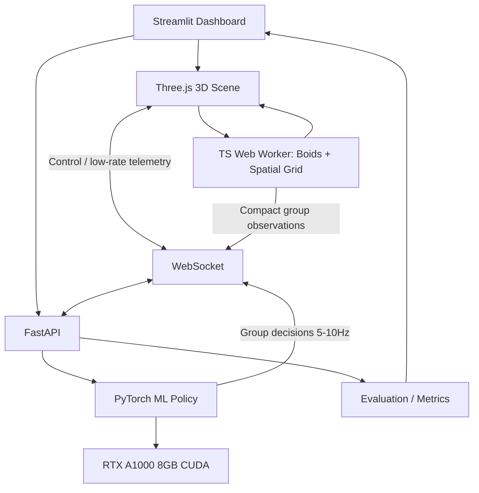

# Smart 3D Ecosystem — Boids + Machine Learning

> Claude Code 実装設計書 / RTX A1000 8GB / Streamlit + Three.js + FastAPI + PyTorch + uv

## 1. 目的

数千体の鳥・魚が 3D 空間で群れを形成し、捕食者を回避しながら餌を探索する自律的エコシステムを可視化する。古典的な Boids に ML による高水準の意思決定を重ね、**ルールベースと学習済み方策の差を定量評価できる**社内向けインタラクティブデモを作る。

**初期対象:** 水中の魚群。鳥群はスキンや環境プリセットで将来拡張する。初期性能目標は 3,000 匹、デスクトップ上で 60 FPS（保証値ではなく計測目標）。

### デモの見せ場

1. 3D 水中世界で 1,000～5,000 匹の魚が群れを形成する。
2. 捕食者を配置すると、魚群が分裂・旋回・再集合する。
3. 餌場を追加すると、魚群が探索・接近する。
4. `Rule-based` と `ML policy` を即座に切り替え、行動とメトリクスの差を確認する。
5. 分離・整列・結合の重みを変えると、群れがリアルタイムに変化する。

## 2. ハードウェア・設計上の前提

- ML 用 GPU: **NVIDIA RTX A1000 8GB**。PyTorch CUDA が動作する Linux を想定。
- Python 環境: Python 3.11、`uv`。
- Web UI: Streamlit。
- 3D レンダリング: Three.js、WebGL2。数千個体の表示には `InstancedMesh` を利用。
- コアの Boids シミュレーション: 最初は TypeScript + Web Worker。空間ハッシュ / uniform spatial grid を使用し、近傍探索を全組み合わせ O(N²) にしない。
- **重要:** WebGL の描画は Web ブラウザ側の GPU で走る。ブラウザを別 PC から開いた場合、サーバー側の RTX A1000 が WebGL 描画するわけではない。A1000 を活用するのは主に ML 学習・推論。ブラウザも A1000 搭載マシン上で動かす場合は同 GPU が使われる可能性があるが、利用 GPU は実測する。
- 大量個体の物理状態を Streamlit の rerun や WebSocket で毎フレーム往復させない。
- WebGPU Compute / CUDA シミュレーションへの移行は、初期ベンチマークを踏まえた追加フェーズとする。

## 3. 技術スタック

| レイヤ | 技術 | 役割 |
|---|---|---|
| ダッシュボード | Streamlit | 個体数、モード切替、メトリクス表示、シナリオ選択 |
| 3D | Three.js + TypeScript + Vite | カメラ、水中環境、InstancedMesh、エフェクト |
| ローカルシミュレーション | TypeScript Web Worker | Boids 更新、空間グリッド、捕食者、餌場 |
| バックエンド | FastAPI + WebSocket | 方策問い合わせ、設定同期、評価イベント受信 |
| ML | PyTorch | 学習済み MLP 方策の推論 |
| RL 学習（第2段階） | Gymnasium + Stable-Baselines3 PPO | 小規模・代表個体/群れで行動方策を学習 |
| 分析 | NumPy, pandas, Plotly | 評価メトリクスと比較チャート |
| 環境/テスト | uv, pytest, Vitest, Playwright | 再現性、品質確認 |

フロントエンド接続方式は、初期は**Streamlit に表示した FastAPI 配信の Vite ビルド画面を iframe として組み込み、データ連携は FastAPI WebSocket 経由**とする。`st.components.v1.html` 依存は避ける。Streamlit Custom Components V2 を用いた密結合は必要になれば追加する。

## 4. アーキテクチャ



### 4.1 データ経路

- Web Worker は **固定タイムステップ**（例: 1/60 秒、負荷増加時は 1/30 秒）でシミュレーションを更新。
- 描画ループは `requestAnimationFrame` で独立して実行。必要なら前後状態から補間。
- Worker → レンダラーの転送には再利用する `Float32Array` / Transferable ArrayBuffer を使い、可能な場合は SharedArrayBuffer を検討（cross-origin isolation が必要なため初期は採用しない）。
- ML は 3D 個体全員に毎フレーム推論しない。**群れを最大 8～32 グループに分け、各グループの状態を 5～10 Hz で問い合わせ**、返された戦略ベクトルを多数の Boids に適用する。
- ML 推論失敗時は前回値を短期間保持し、その後決定論的なルールベースに戻す。
- 観測・アクションのスキーマは `shared/schemas` で明文化し、座標系と単位を固定する。

## 5. Boids アルゴリズム

各個体 `i` は位置 `p_i ∈ R³`、速度 `v_i ∈ R³`、加速度 `a_i ∈ R³`、群れ ID、エネルギー値、生存フラグを持つ。

### 5.1 3 基本ルール

1. **Separation（分離）:** 近すぎる近傍から離れる。
2. **Alignment（整列）:** 周囲の平均速度方向へ向きを合わせる。
3. **Cohesion（結合）:** 近傍の平均位置へ向かう。

運動の基本形:

```text
steering =
    w_sep   * separation(i)
  + w_align * alignment(i)
  + w_coh   * cohesion(i)
  + w_pred  * predator_avoidance(i)
  + w_food  * food_attraction(i)
  + w_wall  * boundary_avoidance(i)
  + w_ml    * learned_group_direction(group(i))

acceleration = clamp_magnitude(steering, max_force)
velocity    = clamp_magnitude(velocity + acceleration * dt, max_speed)
position    = position + velocity * dt
```

- 更新順序によるバイアスを避けるため、同一ステップの旧位置/旧速度を用いて次状態を一括計算する（ダブルバッファ）。
- `dt` を固定し、フレーム落ちの累積を制限する。
- 近傍探索は 3D の一様グリッドで、個体のセルと周辺 26 セルのみを参照。計算量は局所密度に依存し、最悪ケース O(N²) は残るため過密セルを監視する。
- 魚が進行方向を向くように姿勢を計算し、急転回には旋回率制限を設ける。
- 壁境界は反射よりも滑らかな steering を優先。3D 空間は `[-50,50] × [-25,25] × [-50,50]` 程度から調整。

### 5.2 捕食者 / 餌

- 捕食者 1～5 体。最も近い群れ中心を追う簡易ルールベース挙動。
- 魚が捕食者の危険半径内に入ると逃避ステアリングを加算。
- 接触判定により捕食イベントを発火（個体数が変わる場合、InstancedMesh の count / 活性マスクを管理）。
- 餌は 1～10 箇所。一定半径内の個体のエネルギーを回復、餌の量を消費。
- 定期出現または UI での手動出現をサポート。

## 6. ML による高水準の意思決定

### 6.1 ベースラインと ML の役割

- `Boids only`: 群れ形成のみ。
- `Rules + Boids`: 捕食者回避・餌探索に手書きルールを使う。
- `ML + Boids`: **回避・探索・集団維持の優先順位と目的方向を ML が選ぶ**。低レベルの衝突回避は常に Boids が担当する。

> デモ開始時から「学習済み」と偽らないこと。学習が未完了なら明確に `Heuristic policy (untrained)` と表示する。

### 6.2 入力特徴量（一群れ・1推論あたり）

```text
observation = [
  group_center_x, group_center_y, group_center_z,     # 正規化座標
  group_velocity_x, group_velocity_y, group_velocity_z,
  nearest_predator_relative_x, ..._y, ..._z,
  nearest_predator_distance,
  nearest_food_relative_x, ..._y, ..._z,
  nearest_food_distance,
  mean_energy,
  group_density,
  group_dispersion,
  nearby_group_count_normalized,
]
```

入力値の正規化を訓練・推論で共有する。捕食者/餌がいない場合は別途存在フラグを渡すか、明確な sentinel 規約を設ける。

### 6.3 出力

```text
action = [
  desired_direction_x,
  desired_direction_y,
  desired_direction_z,
  predator_avoidance_weight,
  food_attraction_weight,
  cohesion_weight,
]
```

- 方向 3 成分は正規化し、ゼロベクトルは安全に処理。
- 重みは Sigmoid などで有界化し、Boids の基本安全制御の上限を超えて無効化しない。
- 各出力は 0.2 秒程度の平滑化を行い、急激な制御切替を避ける。

### 6.4 学習方式（第2段階）

- Gymnasium 環境を別プロセスで構築し、代表グループ（少数個体）で PPO を学習。
- 初期行動空間は連続 6 次元。SB3 の `MlpPolicy` を用い、小型 MLP から開始。
- 報酬の例:

```text
reward =
    + 1.0 * food_collected
    + 0.2 * survival_time_normalized
    + 0.1 * cohesion_score
    - 2.0 * prey_lost
    - 0.05 * collision_count
    - 0.01 * excessive_steering
```

- 報酬スケール、イベント頻度、学習中のエピソード長を管理。
- 学習・検証用の乱数シード/捕食者速度/餌配置を分離する。
- `random policy`、`handcrafted heuristic` と比較する。
- `torch.save(state_dict)` などで方策を保存し、モデルのバージョン・学習条件を記録。
- PPO を初期成果のブロッカーにしない。MVP は本物のルールベース比較まで実装し、ML 学習は後から追加する。

## 7. Three.js 3D 可視化

### 7.1 世界観

- ダークネイビー背景の水中、控えめなフォグ、柔らかい青/シアン照明。
- 魚は初期段階で 1～2 種類の簡易ローポリ形状を作成。GLTF に依存しない。
- 役割別に魚群色を変更。捕食者は大きな赤系形状。餌は発光粒子群。
- オプションで尾びれの簡易アニメーション、パーティクルトレイル、淡いブルーム。
- UI は学習の比較が中心で、過度なポストプロセッシングをデフォルト OFF にする。

### 7.2 高速描画

- 同じジオメトリを繰り返し描く場合は `THREE.InstancedMesh` を使う。
- 各フレーム、位置と向きから行列を更新し、更新後に `instanceMatrix.needsUpdate = true` を指定する。
- 各魚に個別の Mesh、React コンポーネント、マテリアルを割り当てない。
- 色変化はインスタンスカラーを活用し、頻繁に全色を書き換えない。
- 配列や `Vector3` の毎フレーム大量生成を避ける。
- パフォーマンス劣化時の段階的品質低下: trail OFF → bloom OFF → 尾びれ簡略化 → 個体数減。

### 7.3 UI レイアウト

```text
┌──────────────────────────────────────────────────────────────┐
│ SMART 3D ECOSYSTEM                  FPS | Agents | Mode      │
├───────────────┬──────────────────────────────────────────────┤
│ Controls      │                                              │
│ [Population]  │          Interactive 3D Aquarium            │
│ [Predators]   │                                              │
│ [Food]        │       fish schools, trails, predators       │
│ [Policy]      │                                              │
│ [Boids gains] │                                              │
│ [Reset/Pause] │                                              │
├───────────────┴──────────────────────────────────────────────┤
│ Survival Rate  | Food Collected | Cohesion | FPS | Step Time │
│ Time-series comparison: Boids / Rules / ML                    │
└──────────────────────────────────────────────────────────────┘
```

- OrbitControls: 回転/ズーム/パン。
- デモプリセット: `Calm School`, `Predator Attack`, `Food Rush`, `ML vs Rules`。
- 比較は同じシードと同じシナリオに対する**別ラン**を用いる。2 条件の世界が干渉しないよう、状態を分離する。

## 8. API とイベント定義

### HTTP

- `GET /health`: 状態確認、CUDA 利用可否、モデル読み込み状態。
- `GET /api/config`: 初期シミュレーション設定。
- `GET /api/policies`: `boids`, `rules`, `ml` と各 availability。
- `GET /api/metrics`: 比較・履歴（取得可能な範囲を明記）。
- `POST /api/experiments/reset`: 実験 ID / シードで測定を初期化。

### WebSocket `WS /ws/simulation/{experiment_id}`

クライアント → サーバー:

```json
{
  "type": "policy_request",
  "request_id": "req-001",
  "tick": 120,
  "observations": [
    {"group_id": 0, "features": [0.1, 0.2, 0.3]}
  ]
}
```

※ 上記 `features` は説明用の短縮例。実装ではセクション 6.2 と整合する固定長スキーマを検証する。

サーバー → クライアント:

```json
{
  "type": "policy_response",
  "request_id": "req-001",
  "model_version": "ppo-v1",
  "actions": [
    {"group_id": 0, "direction": [0.2, 0.7, 0.1], "weights": [0.9, 0.4, 0.6]}
  ]
}
```

- サーバーは一括推論し、古い `tick` のレスポンスをクライアントで棄却。
- 1 メッセージあたりのバイト数とグループ数を制限。
- WebSocket 切断時は `rules` に自動フォールバックし、画面に表示。
- Streamlit とシーン間の設定同期は REST または Streamlit コンポーネント経由で、設定頻度に応じて扱う。競合する設定変更の優先順位を定義。

## 9. 評価指標

| 指標 | 定義 | 目的 |
|---|---|---|
| Survival Rate | 生存個体数 / 初期個体数 | 捕食者回避の有効性 |
| Food Collected | 回収した餌の総量 | 探索能力 |
| Mean Energy | 生存個体の平均エネルギー | エコシステムの持続可能性 |
| Group Dispersion | グループ中心からの平均距離 | 群れのまとまり |
| Collision Count | 個体・障害物の衝突回数 | 安定性 |
| Render FPS | ブラウザ側フレームレート | 描画性能 |
| Simulation Step ms | 1物理ステップの時間 | アルゴリズム性能 |
| ML Latency p50/p95 | 方策 API 推論応答時間 | ML 実用性 |

- Boids-only / Rules / ML は同じ初期乱数シード・敵配置・餌配置・試行時間で比較。
- 5～10 シードの平均値とばらつきを表示。
- 初期負荷テストは 500 / 1,000 / 3,000 / 5,000 個体で計測。目標 3,000 @ 60 FPS はあくまで目標値。
- GPU VRAM は `nvidia-smi`、CPU/プロセス資源は OS メトリクスで観測。

## 10. 推奨ディレクトリ構成

```text
smart-3d-ecosystem/
├── README.md
├── CLAUDE.md
├── design_doc.md
├── pyproject.toml
├── uv.lock
├── .env.example
├── backend/
│   ├── __init__.py
│   ├── main.py                 # FastAPI + 静的配信
│   ├── schemas.py              # API 入出力スキーマ
│   ├── ws.py                   # WebSocket
│   ├── policy.py               # rules / ml policy
│   ├── metrics.py              # 評価と実験 ID
│   └── models/                 # 学習済み weight（任意）
├── dashboard/
│   └── app.py                  # Streamlit
├── frontend/
│   ├── package.json
│   ├── index.html
│   ├── vite.config.ts
│   ├── src/
│   │   ├── main.ts
│   │   ├── scene/Scene.ts
│   │   ├── scene/FishRenderer.ts
│   │   ├── sim/boids.worker.ts
│   │   ├── sim/spatialGrid.ts
│   │   ├── sim/boids.ts
│   │   ├── sim/predator.ts
│   │   ├── sim/food.ts
│   │   ├── api/websocket.ts
│   │   └── ui/controls.ts
│   └── tests/
├── training/
│   ├── env.py                  # Gymnasium environment
│   ├── train_ppo.py
│   ├── evaluate.py
│   └── configs/
├── tests/
│   ├── test_api.py
│   ├── test_policy.py
│   └── test_env.py
└── scripts/
    ├── dev.sh
    ├── benchmark.sh
    └── check_gpu.py
```

- `backend/models/` の大容量チェックポイントは Git にコミットしない。
- シード、評価結果、ハイパーパラメータは CSV/JSON として保存できるようにする。

## 11. 実装フェーズと完了条件

### Phase 1 — 3D + Boids MVP

- Three.js で 1,000～3,000 匹の魚を InstancedMesh 表示。
- 分離・整列・結合・境界回避を実装。
- 空間ハッシュ、固定ステップ、Web Worker。
- OrbitControls、プリセット、FPS 表示。
- **完了条件:** 1,000 匹で群れ形成が目視可能。計測ログを保存できる。

### Phase 2 — 捕食者、餌、Streamlit 連携

- 捕食者、餌の追加・削除・配置。
- Rule-based 行動モード。
- FastAPI / WebSocket / Streamlit 画面。
- 生存率、餌獲得量、群れの分散度を可視化。
- **完了条件:** `Predator Attack` と `Food Rush` が操作可能。再現可能なシードあり。

### Phase 3 — ML 方策統合

- ML の観測・アクション仕様を固定。
- A1000 上で動く小型 MLP と一括推論 API を実装。
- 初期は簡単な模倣学習またはテスト用小型モデルから始め、学習の種類を UI に表示。
- ML と Rules の切替、遅延計測、フォールバック。
- **完了条件:** ML の入力が実測観測、出力がシミュレーションの行動に反映される。

### Phase 4 — PPO 学習・評価

- Gymnasium 環境、PPO 学習、評価スクリプト。
- 学習前後および Rules vs ML の同条件比較。
- シードごとの結果集計、学習曲線。
- **完了条件:** 方策チェックポイントから再現推論でき、複数試行の評価レポートが出力される。

### Phase 5 — 演出・最適化（任意）

- 高品質な水中フォグ、尾びれ、軌跡、発光演出。
- 必要なら WebGPU Compute、GPU ベース状態更新を検討。
- プリセット/録画しやすいカメラ操作。
- **完了条件:** 高画質とパフォーマンスモードの双方が使用可能。

## 12. Claude Code の開発ルール

1. **小さな垂直スライス**を実装する。まず Boids と描画だけで見える状態を作る。
2. WebGPU、GPU カーネル、RL を Phase 1 の必須条件にしない。
3. 3D 描画と Python ML を疎結合に保つ。
4. 高頻度個体状態はクライアント内で処理し、WebSocket には群れ要約のみ送る。
5. Python は `uv`、TypeScript は npm。全ての依存を明示する。
6. 完了したフェーズで unit test、E2E smoke test、性能計測を行う。
7. 描画なしでも Boids の数値テストを実行できるようにする。
8. 性能改善はプロファイルでボトルネックを特定してから着手する。
9. CUDA が利用不能でも `rules` モードは CPU で動くようにする。
10. シードの固定、ログ、例外処理、WebSocket 再接続、モデル未ロード表示を実装する。

### 必須テスト

- 個体間距離がゼロでも NaN/Infinity を発生させない。
- 位置や速度の数値が 10,000 ステップ後も有限。
- 個体数変更時、描画バッファと状態配列が不整合にならない。
- 固定シード・固定 dt の deterministic な Boids コアが再現可能。
- 不正スキーマや推論タイムアウトでは安全に Rules に戻る。
- 同時接続の実験 ID が混線しない。
- 観測正規化は学習と推論で同一。

## 13. 開発・起動コマンド（実装後の想定）

```bash
# Python 依存環境を準備
uv sync

# 3D フロントエンド依存を準備
cd frontend && npm install && cd ..

# ターミナル1: FastAPI
uv run uvicorn backend.main:app --reload --port 8000

# ターミナル2: Vite 開発サーバー
cd frontend && npm run dev

# ターミナル3: Streamlit
uv run streamlit run dashboard/app.py --server.port 8501

# GPU 確認
uv run python scripts/check_gpu.py

# 学習（Phase 4）
uv run python -m training.train_ppo

# バックエンドテスト
uv run pytest

# フロントエンドテスト
cd frontend && npm test
```

注: コマンドは実装対象の設計インターフェース。現時点で完成済みのリポジトリを示すものではない。CUDA 対応 PyTorch は Linux / CUDA / Python に適合する wheel を公式手順に従って入れる。

## 14. Claude Code 初回プロンプト

```text
このリポジトリの design_doc.md を読み、Smart 3D Ecosystem の Phase 1 を実装してください。

必須事項:
- uv + Python 3.11、Vite + Three.js + TypeScript
- 3D 魚群の InstancedMesh 表示
- separation / alignment / cohesion / boundary avoidance
- Web Worker と空間ハッシュ
- 固定時間ステップ、再現可能な乱数 seed
- マウスでカメラ操作、魚数調整、Boids 重み調整
- FPS とシミュレーション step ms を表示
- テスト、README、起動スクリプト

まず設計の要点と実装 TODO を示し、その後 Phase 1 を実装してください。
重い CUDA 計算、RL 学習、WebGPU 移行はまだ実装しないでください。
実装後、テストの成否と既知の性能制約を報告してください。
```

## 15. 参考リンク

- Three.js InstancedMesh: https://threejs.org/docs/pages/InstancedMesh.html
- Three.js documentation: https://threejs.org/docs/
- Streamlit custom components: https://docs.streamlit.io/develop/api-reference/custom-components
- FastAPI WebSockets: https://fastapi.tiangolo.com/advanced/websockets/
- Gymnasium: https://gymnasium.farama.org/
- Stable-Baselines3 PPO: https://stable-baselines3.readthedocs.io/en/master/modules/ppo.html
- Reynolds, C. W. (1987), *Flocks, Herds, and Schools: A Distributed Behavioral Model*: https://www.red3d.com/cwr/boids/

---

**推奨 GitHub リポジトリ名:** `smart-3d-ecosystem`
